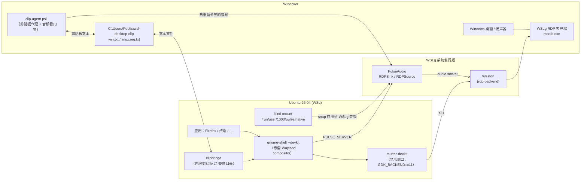

# WSL2 嵌套 GNOME 桌面（Ubuntu 26.04 / WSLg）

<p align="center">
  
  
  
  
</p>

<p align="center">
  在 <b>Windows + WSL2 + WSLg</b> 上跑出一个完整可用的 <b>Ubuntu 26.04 GNOME 50 桌面</b>，并补齐 WSLg 的两块短板：<b>剪贴板双向同步</b> 与 <b>嵌套桌面的声音</b>——启动脚本每次都会自动自检、卡死就热重启（约 3 秒），不用重装、也不用手动重启 WSL。
</p>

<p align="center">
  <a href="wsl-desktop/README.md">使用说明</a> ·
  <a href="wsl-desktop/REPORT.md">完整技术报告</a> ·
  <a href="wsl-desktop/TROUBLESHOOTING.md">排障指南</a>
</p>

---

## 🚑 遇到问题？

桌面窗口不出来、启动报 `A graphical session is already running!`、声音卡死/没声、剪贴板不生效……
全部整理在 **[TROUBLESHOOTING.md](wsl-desktop/TROUBLESHOOTING.md)** —— **全程复制粘贴，不需要懂 Linux**。

## ⚡ 一键脚本（给不会 Linux 的人）

| 脚本 | 用途 |
|---|---|
| [oneclick/install.ps1](oneclick/install.ps1) | 一键安装：检查 WSLg → 装桌面 → 配剪贴板/声音 → 启动桌面 |
| [oneclick/start-desktop.ps1](oneclick/start-desktop.ps1) | **一键启动桌面（后台运行，立即返回，不占用终端）**；也支持 `-Status` / `-Stop` / `-FixOnly` / `-Wait`（双击 `start-desktop.cmd` 亦可，**任意目录可用**） |
| [oneclick/show-paths.ps1](oneclick/show-paths.ps1) | **必读**：显示本机实际路径 + 列出所有含占位符的脱敏文件，可 `-Apply` 自动填写（公开仓库用户先跑这个） |
| [oneclick/fix-audio.ps1](oneclick/fix-audio.ps1) | 一键修声音：先让 `~/start-desktop.sh --fix` 自检并热重启音频（约 3 秒），不行再重启 WSL → 重开桌面 |
| [oneclick/restart-desktop.ps1](oneclick/restart-desktop.ps1) | 一键重开桌面（清理残留会话 + 启动，同时修声音/剪贴板） |

```powershell
# 0) 公开仓库（脱敏版）：先把占位符换成你自己的路径
powershell -ExecutionPolicy Bypass -File .\oneclick\show-paths.ps1

# 1) 一键安装
powershell -ExecutionPolicy Bypass -File .\oneclick\install.ps1

# 2) 以后启动桌面（后台启动，窗口不占用）
powershell -ExecutionPolicy Bypass -File .\oneclick\start-desktop.ps1
```

三个脚本都是**自包含**的：把内容整段复制给别人、保存成 `.ps1` 就能运行，对方不需要本仓库。

> ⚠️ `.\oneclick\...` 这种写法要求**当前目录是仓库根目录**。如果 PowerShell 在
> `C:\windows\System32` 等其它目录（从开始菜单打开时是默认值），会报
> `-File 形式参数的实际参数“.\oneclick\start-desktop.ps1”不存在`。
> 用完整路径、先 `cd` 到仓库、或双击 `oneclick\start-desktop.cmd`（自动定位）即可；
> 也可以完全不依赖路径，直接：
>
> ```powershell
> wsl -d Ubuntu -u <用户名> -- bash -lc "~/start-desktop.sh"      # 启动桌面（幂等，立即返回）
> ```
>
> 另外：**不要反复手动执行 `systemd-run --user --unit=wsl-desktop-session ...` 原命令**——
> 单元已存在时它会报 `already loaded`（属正常），日常用 `~/start-desktop.sh` 即可。

## ⚠️ 公开仓库（脱敏版）必读：先把自己的路径填进去

公开仓库里的文档/脚本是**脱敏版**，个人路径都换成了占位符：

| 占位符 | 含义 | 你该填 |
|---|---|---|
| `C:\Users\<用户名>` | Windows 用户目录 | `C:\Users\你的Windows用户名` |
| `/home/<用户名>` | WSL 用户目录 | `/home/你的WSL用户名` |
| `<用户名>` / `<主机名>` | 用户名 / 主机名 | 用脚本输出的实际值 |
| `~/wsl2-nested-gnome-desktop` | 仓库实际位置 | 用脚本输出的 WSL 路径 |

**必须先运行下面的脚本**：它会显示你本机的实际路径、列出公开仓库里所有含占位符的**脱敏文件位置**，并给出「占位符 → 你的值」对照表，照着填即可：

```powershell
# 在仓库根目录运行（只查看，不改文件）
powershell -ExecutionPolicy Bypass -File .\oneclick\show-paths.ps1

# 确认后自动替换（会修改文档/脚本；建议先 git status）
powershell -ExecutionPolicy Bypass -File .\oneclick\show-paths.ps1 -Apply
```

如果仓库只在 WSL 里，也可以在 WSL 终端运行同样的功能：

```bash
bash ~/wsl2-nested-gnome-desktop/oneclick/show-paths.sh          # 查看 + 列出脱敏文件
bash ~/wsl2-nested-gnome-desktop/oneclick/show-paths.sh --apply  # 自动替换
```

**不替换的后果**：命令里的 `C:\Users\<用户名>`、`~/wsl2-nested-gnome-desktop` 等路径在你机器上不存在，安装/启动会直接失败。
（如果你拿到的是**实际路径版**，脚本会提示「未发现占位符」，跳过这一步即可。）

## 📌 这是什么

本仓库最初来自对两个 Gist 的复现研究：

- [Xwayland 版教程](https://gist.github.com/tdcosta100/e28636c216515ca88d1f2e7a2e188912)（完整桌面 + GDM 登录界面）
- [Wayland 嵌套版教程](https://gist.github.com/tdcosta100/7def60bccc8ae32cf9cacb41064b1c0f)（mutter devkit 嵌套桌面）

结论：**Xwayland 教程在 Ubuntu 26.04 上已经不可行**（GNOME 50 移除了 X11 会话，GDM 也移除了 X11 支持），所以本仓库提供两条实际可用的路线，并以路线 A 为主：

| 路线 | 适用发行版 | 效果 | 本质 |
|---|---|---|---|
| **A（本仓库主线）** | Ubuntu 26.04 | 一个 GNOME 桌面窗口（mutter devkit），无登录界面 | 嵌套 GNOME 会话 + WSLg 显示 |
| **B（保留脚本）** | 仅 Ubuntu 24.04 | 带 GDM 登录界面的完整桌面 | 替换 Xorg + Xwayland + GDM |

在此之上，本仓库解决了两个在嵌套桌面里最影响日常使用的问题：

| 问题 | 现象 | 解决 |
|---|---|---|
| **剪贴板** | 能复制不能粘贴 / 双向都不通 | 独立于 WSLg 的新方案：Windows 侧常驻代理 `clip-agent.ps1` + 文件邮箱 + WSL 侧 `clipbridge`，**纯文本双向**，延迟约 0.5~2 秒（WSLg 的 RDP 剪贴板通道会卡死，已绕开） |
| **声音** | 设置里无输出设备；闹铃有声但浏览器没声 | 启动时自动检测并**热重启**卡死的 WSLg PulseAudio（约 3 秒恢复）+ 把 snap 应用音频路由回 WSLg + Windows 侧代理每 20 秒看门狗兜底 |

---

## ✨ 功能特性

- 🖥️ **完整 GNOME 50 桌面**：窗口化运行，由 systemd 用户单元托管，**关掉终端也不会退出**
- ⚡ **后台启动、不占终端**：`~/start-desktop.sh`（或 Windows 里 `oneclick/start-desktop.ps1`）会立即返回，桌面在后台启动；需要前台看日志才用 `--foreground`
- 🧯 **会话自愈**：桌面窗口关掉后再次 `~/start-desktop.sh` 会自动清理残留会话（不再报 “A graphical session is already running!”）
- 🪟 **应用窗口留在桌面内**：从 Ubuntu 桌面里启动的应用（GTK/Qt/snap/Flatpak）不再变成 Windows 上单独的窗口——gnome-shell 不再强制 `GDK_BACKEND=x11`，只有「桌面窗口」由包装脚本单独走 X11；apt 升级后启动脚本会自愈（见 TROUBLESHOOTING 4.9）
- 📋 **剪贴板双向**：Linux ⇄ Windows（纯文本），中文/多行正常；**不依赖 WSLg 剪贴板通道**，WSLg 卡死也不影响
- 🔊 **声音直通 Windows**：内层应用与 snap 版 Firefox 都经 WSLg 播放到 Windows 默认扬声器；**启动时自动检测 + 热重启卡死的音频服务（约 3 秒）**
- 🐕 **看门狗兜底**：Windows 侧代理每 20 秒检查一次音频，卡死会自动关面板 + 热重启，日志可查
- 🔁 **自启动/自恢复**：`~/start-desktop.sh` 每次都会拉起剪贴板代理、剪贴板桥、音频环境；服务都 enabled，WSL 重启后自动恢复
- 🧰 **诊断与恢复工具**：`~/start-desktop.sh --check`（声音/剪贴板/会话一屏看完）、`audio-watch.sh`、一键修复 `fix-audio.ps1`
- 📚 **完整文档**：使用说明 + 技术报告（根因分析、验证矩阵、排障手册、复现步骤）

---

## 🗺️ 架构



---

## 🚀 快速开始

> 前提：Windows 10 22H2+ / Windows 11，WSL2 + WSLg（`.wslconfig` 里 `guiApplications=true`），Ubuntu 26.04 内 `systemd=true`。

```powershell
wsl --version    # 确认 WSL / WSLg 版本
```

> 推荐在 WSL 里克隆本仓库：`git clone <本仓库地址> ~/wsl2-nested-gnome-desktop`。
> 下面的命令默认仓库位于 WSL 的 `~/wsl2-nested-gnome-desktop`（或 Windows 的 `C:\Users\<用户名>\Desktop\wsl2-nested-gnome-desktop`），路径不同请自行替换。

```bash
# 1) 安装桌面组件（一次性）
sudo apt-get update
sudo apt-get install -y ubuntu-desktop mutter-dev-bin

# 2) 安装本仓库的脚本（路径按你的实际位置调整）
sudo bash ~/wsl2-nested-gnome-desktop/wsl-desktop/audio/install-audio.sh
sudo bash ~/wsl2-nested-gnome-desktop/wsl-desktop/clipboard/install-clipbridge.sh

# 3) 启用剪贴板服务 + 应用 snap 音频路由
bash ~/wsl2-nested-gnome-desktop/wsl-desktop/clipboard/enable-clipbridge.sh
bash ~/wsl2-nested-gnome-desktop/wsl-desktop/audio/setup-snap-audio.sh

# 4) 重启 WSL（Windows 侧）让 WSLg 重新初始化
#    PowerShell: wsl --shutdown

# 5) 启动桌面（后台启动，终端立即释放；启动时会自动修音频 + 拉起剪贴板代理/桥）
~/start-desktop.sh

#   Windows 任意目录都能用（不占终端，幂等）：
#   wsl -d Ubuntu -u <用户名> -- bash -lc "~/start-desktop.sh"
#   也可以双击/运行 oneclick\start-desktop.ps1（在仓库目录；或双击 start-desktop.cmd 自动定位）
#   旧的 systemd-run 写法仍然兼容，但只在“单元不存在”的首次启动用；
#   单元已存在时它会报 already loaded（正常），日常统一用上面的 ~/start-desktop.sh
```

之后会弹出一个标题为 **Mutter Development Kit** 的窗口——就是你的 Ubuntu 桌面（关掉窗口 = 关掉桌面）。

日常「声音/剪贴板又不对了」只要在 WSL 里跑一条（桌面在跑也安全，只做修复）：

```bash
~/start-desktop.sh --fix      # 只修声音/剪贴板（同步，不启动桌面）
~/start-desktop.sh --check    # 一屏看声音/剪贴板/会话状态
~/start-desktop.sh            # 后台启动桌面（立即返回，不占用终端）
~/start-desktop.sh --foreground   # 前台启动（占用终端，调试用）
```

---

## 📂 目录结构

```text
.
├── README.md                        # 本文件：项目概览
├── oneclick/                        # 给"不会 Linux"的人的一键脚本（自包含）
│   ├── show-paths.ps1               # 公开仓库必读：查看实际路径 / 列出脱敏文件 / -Apply 自动填写
│   ├── show-paths.sh                # 同一功能（WSL 版）
│   ├── start-desktop.ps1            # 一键启动桌面（后台，不占终端；-Status/-Stop/-FixOnly/-Wait）
│   ├── start-desktop.cmd            # 双击启动（调用上面的 ps1）
│   ├── install.ps1                  # 一键安装（内嵌全部配置）
│   ├── fix-audio.ps1                # 一键修声音
│   ├── restart-desktop.ps1          # 一键重开桌面
│   └── README.md                    # 一键脚本说明
└── wsl-desktop/
    ├── README.md                    # 使用说明（桌面 / 剪贴板 / 声音）
    ├── REPORT.md                    # 完整技术报告（根因、验证、排障）
    ├── TROUBLESHOOTING.md           # 🚑 故障排除指南（复制粘贴即可）
    ├── wsl-desktop-2604.sh          # 路线 A：26.04 嵌套 GNOME 一键脚本（安装/回滚）
    ├── wsl-desktop-2604-rdp.sh      # 路线 A 可选：GNOME Remote Desktop（RDP）
    ├── wsl-desktop-2404-xwayland.sh # 路线 B：24.04 Xwayland 教程自动化
    ├── clipboard/
    │   ├── clip-agent.ps1          # Windows 侧常驻代理：双向文本剪贴板 + 音频看门狗
    │   ├── clipbridge.sh           # WSL 侧桥：内层 GNOME 剪贴板 ⇄ 交换目录
    │   ├── wsl-clipbridge.service  # 剪贴板桥 systemd 用户服务
    │   ├── install-clipbridge.sh   # root 安装脚本
    │   ├── enable-clipbridge.sh    # 用户启用/重启脚本
    │   ├── start-desktop.sh        # 桌面启动脚本（自愈残留会话 + 音频修复 + 拉起代理/桥）
    │   └── final-clip-test.sh      # 剪贴板双向自测
    └── audio/
        ├── install-audio.sh        # root：PULSE_SERVER / override / bind 守护
        ├── setup-snap-audio.sh     # 用户：mask pipewire-pulse + 路由检查
        ├── restart-desktop.sh      # 重启桌面会话
        ├── stop-desktop.sh         # 停止/清理桌面会话（含残留会话管理器）
        ├── fix-audio.ps1           # Windows：一键修声音
        ├── audio-watchdog.ps1      # Windows：旧版看门狗（现已内置进 clip-agent.ps1，保留作参考）
        ├── audio-watch.sh          # WSL：每 5 秒记录音频状态
        ├── diag-session.sh         # 会话状态诊断
        └── diag-audio-playback.sh  # 音频播放链路诊断
```

---

## ✅ 实测状态

| 项目 | 结果 |
|---|---|
| 桌面窗口（GNOME 50.1 + mutter-devkit） | ✅ 运行中 |
| 桌面会话托管（systemd user unit） | ✅ 关终端不退出 |
| 剪贴板 Linux → Windows | ✅ 约 0.5~2 秒（`clip-agent.ps1`） |
| 剪贴板 Windows → Linux | ✅ 约 0.5~2 秒（`clipbridge` ⇄ 代理） |
| 剪贴板中文双向 | ✅ |
| 应用窗口归属 | ✅ 启动的应用留在 Ubuntu 桌面窗口内（嵌套 Wayland；纯 X11 应用除外） |
| 声音输出 / 输入 | ✅ `RDPSink` / `RDPSource` |
| 启动时自动修复音频卡死 | ✅ 实测约 3 秒恢复（17:03 桌面重启、17:11 手工 kill 各一次） |
| 音频看门狗（Windows 代理） | ✅ 每 20 秒检测，日志 `C:\Users\Public\wsl-desktop-clip\agent.log` |
| 浏览器（snap Firefox）声音 | ✅ 经 WSLg 播放到 Windows |
| WSL 重启后自动恢复 | ✅ 服务 enabled，socket 自动重新挂载 |

---

## ⚠️ 已知限制

- **WSLg 音频仍可能周期性卡死**（WSLg 1.0.79 的 bug）：`~/start-desktop.sh` 每次启动会自动热重启修复（约 3 秒），Windows 侧代理每 20 秒看门狗兜底；**通常不再需要 `wsl --shutdown`**。需要「绝对稳定音频」建议改用 RDP 桌面方案。
- **剪贴板仅文本**，图片/文件不同步；双向同步有约 0.5~2 秒延迟；WSLg 自带的 RDP 剪贴板通道（会卡死）已不再使用。
- **无登录界面**（除非 RDP）；分辨率/全屏受限；嵌套桌面走软件渲染，动画/视频较慢。
- **系统升级风险**：GNOME / WSL 升级后 `--devkit` 行为可能变化。
- **嵌套会话里 Ubuntu 桌面图标扩展（ding）会以 X11Wayland 运行**：反复重建桌面窗口，导致任务栏图标闪烁/弹「警告」；`~/start-desktop.sh` 已默认禁用（想恢复桌面图标：`gnome-extensions enable ding@rastersoft.com`）。
- **剪贴板同步已改为 GNOME Shell 扩展（`clipbridge@wsl-desktop`）**：在 shell 内部直接读写剪贴板，不再每 0.2 秒调用 `wl-paste`（旧方式会创建临时窗口，Dock 会把它当“未知应用”刷出齿轮图标、还会抢焦点）；Dock 的“运行中程序”图标保持开启。
- **纯 X11 应用仍会跑到 Windows 外层**：嵌套会话没有自己的 X 服务器；Wayland 应用（GNOME/GTK、Qt、snap、Flatpak 等）都能留在 Ubuntu 桌面窗口内。遇到某个应用跑出去，先看 TROUBLESHOOTING 4.9。

---

## 📖 文档

- [🚑 故障排除指南（wsl-desktop/TROUBLESHOOTING.md）](wsl-desktop/TROUBLESHOOTING.md) —— **遇到问题先看这个**，全程复制粘贴
- [⚡ 一键脚本说明（oneclick/README.md）](oneclick/README.md) —— 安装 / 修声音 / 重开桌面，可直接发给别人
- [使用说明（wsl-desktop/README.md）](wsl-desktop/README.md) —— 桌面、剪贴板、声音的操作与命令
- [完整技术报告（wsl-desktop/REPORT.md）](wsl-desktop/REPORT.md) —— 架构、根因分析、验证矩阵、排障手册、从零复现
- 参考：[GNOME 50 移除 X11](https://itsfoss.com/news/gnome-50-release/) · [WSLg 项目](https://github.com/microsoft/wslg) · [WSLg 音频 issue #1468](https://github.com/microsoft/wslg/issues/1468)

---

<p align="center">
  <sub>由 DeepSeek Harness 协助整理 · 持续更新</sub>
</p>
